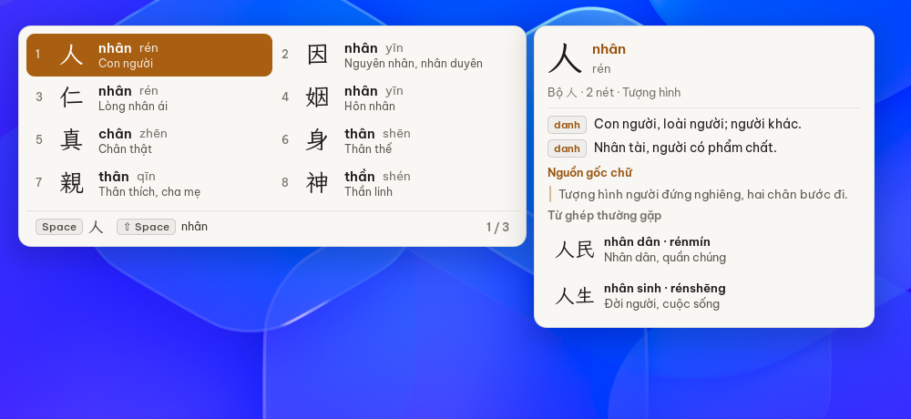
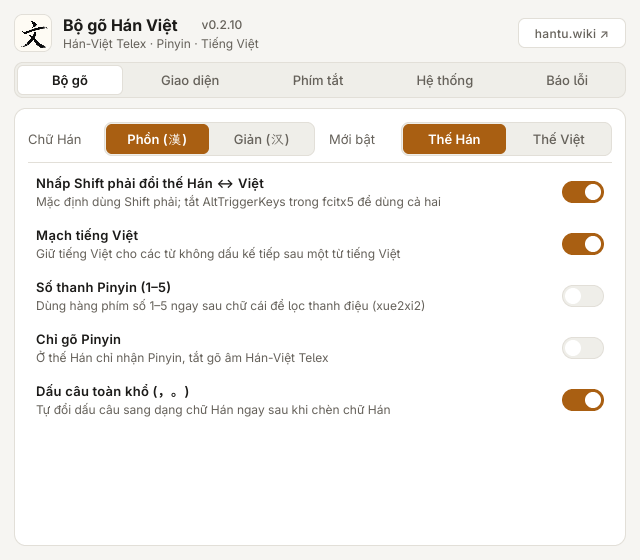
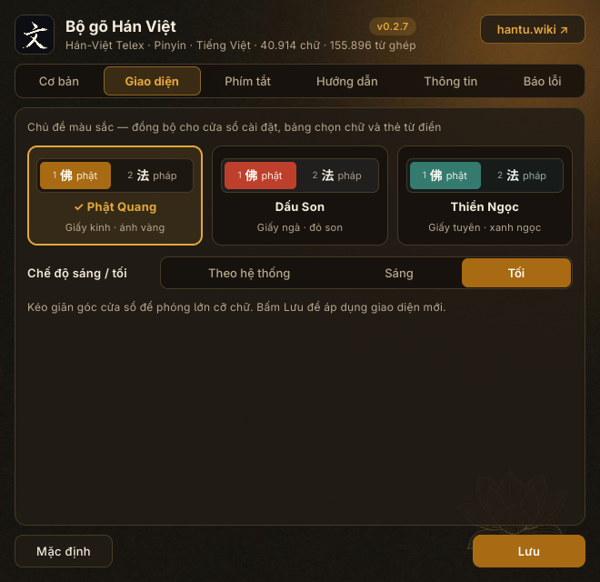

# Bộ gõ Hán Việt

Bộ gõ chữ Hán đa nền tảng (**Android** · **Windows** · **Linux `fcitx5`**) cho phép gõ **âm Hán-Việt (Telex)**, **Pinyin** và **tiếng Việt** mượt mà ngay trên cùng một dòng mà không cần chuyển bộ gõ. Hỗ trợ cả **Phồn thể** lẫn **Giản thể**, tích hợp từ điển chiết tự và thuật ngữ Phật học ngay tại con trỏ.

- **Kho dữ liệu đi kèm:** `40.914` chữ đơn · `155.896` từ ghép · `148.985` mục giải nghĩa chi tiết.
- **Nguyên tắc:** Phi lợi nhuận · Miễn phí · Không quảng cáo · Chạy 100% ngoại tuyến, không thu thập dữ liệu.
- **Tác giả:** Hue Hung, Claude & Gemini · **Trang chính:** [hantu.wiki](https://hantu.wiki) · **Trang tải:** [hantu.wiki/bo-go](https://hantu.wiki/bo-go)

---

## Gõ thử trong một dòng

| Chuỗi phím gõ | Kết quả | Cơ chế tự nhận diện |
|---|---|---|
| `nhaan` + `Space` | **人** | Âm Hán-Việt kiểu Telex |
| `nhanduyen` + `Space` | **因緣** | Gõ liền cả cụm, tự tách âm và đưa từ ghép lên đầu |
| `batnha` + `Space` | **般若** | Tích hợp từ vựng thông dụng và thuật ngữ Phật học |
| `xuexi` / `duibuqi` | **學習** / **對不起** | Pinyin xếp theo tần suất hiện đại (tự theo Phồn/Giản) |
| `của người xưa` | **của người xưa** | Từ tiếng Việt không khớp chữ Hán hoặc đang trong mạch câu Việt |

---

## Hình ảnh tham khảo


*Bảng chọn chữ 2 cột (tùy chỉnh 1–4 cột) cùng thẻ từ điển chi tiết khi rê chuột dừng 0,3 giây trên máy tính hoặc bấm giữ trên điện thoại: hiện bộ thủ, số nét, lục thư, nghĩa, nguồn gốc chữ và từ ghép liên quan.*

| Cửa sổ cài đặt chung (Windows & Linux) | 3 chủ đề đồng bộ Sáng / Tối |
|---|---|
|  |  |
| *Chỉnh nhanh Phồn/Giản, Thế mặc định, số ô gợi ý, số cột và quy tắc gõ.* | *3 chủ đề **Phật Quang**, **Dấu Son**, **Thiền Ngọc** tự phóng chữ khi kéo giãn cửa sổ.* |

---

## Hướng dẫn thao tác nhanh

### Trên máy tính (Windows & Linux `fcitx5`)

| Phím / Chuột | Tác dụng |
|---|---|
| `Space` | Chèn chữ Hán đang chọn; nếu không chọn ô nào thì chèn tiếng Việt |
| `Shift + Space` | Luôn chèn tiếng Việt kèm dấu cách |
| `1–9` / Nhấp chuột | Chọn nhanh chữ theo số thứ tự; lăn chuột để lật trang |
| Rê chuột dừng `0,3s` | Mở thẻ từ điển chi tiết (bấm chữ thành phần để tra nối tiếp) |
| `← → ↑ ↓` | Di chuyển ô chọn (`→` lần đầu bật chọn chữ Hán khi đang ưu tiên tiếng Việt) |
| `Tab` / `PgUp` · `PgDn` / `- =` | Lật sang trang tiếp theo hoặc quay lại trang trước (`Shift + Tab`, `-`) |
| `Shift` (nhấp nhả) | Đổi nhanh **Thế Hán ↔ Thế Việt** *(trên Linux mặc định dùng Shift phải)* |
| `Numpad` / `Alt + 1…5` | Đặt thanh điệu Pinyin ngay sau âm tiết (`5` hoặc `0` = thanh nhẹ) |
| `Ctrl + Shift + Space` | Bật / tắt chế độ dùng hàng phím số `1–5` gõ thanh điệu Pinyin |
| `Ctrl + Alt + Space` | Tạm tắt / bật lại bộ gõ (**EN** — gõ trực tiếp tiếng Anh, lập trình) |

### Trên điện thoại Android

- **Phím đổi thế:** chạm để đổi **Latin ↔ Chữ Hán**; bấm giữ để đổi **Vi ↔ EN** (ở Latin) hoặc **Phồn ↔ Giản** (ở chữ Hán).
- **Thanh gợi ý 3 tầng:** hiện đồng thời âm Hán-Việt, chữ Hán (font Khải thư *LXGW WenKai* + *Jigmo*) và Pinyin; chạm nút `▾` để mở lưới rộng, gạt **Chỉ Pinyin** nếu không dùng Hán-Việt.
- **Tra từ điển ngay trên phím:** bấm giữ một ô gợi ý để xem bộ thủ, số nét, lục thư, nghĩa, nguồn gốc chữ và chiết tự từng chữ.
- **Pinyin có dấu & dấu câu Trung văn:** bấm giữ `a e i o u v` để chọn `ā á ǎ à, ü`; trang ký hiệu riêng `。，、「」『』《》…`.

---

## Cài đặt theo thiết bị

### 1. Android (Android 9 trở lên)

1. Mở [hantu.wiki/bo-go](https://hantu.wiki/bo-go) bấm **Tải APK**, hoặc tải `han-tu-ime.apk` tại mục [Releases](../../releases/latest).
2. Mở tệp vừa tải và cho phép cài đặt ứng dụng. Nếu Google Play Protect hỏi, chọn **Chi tiết** → **Vẫn cài đặt** *(xem lý do bên dưới)*.
3. Mở ứng dụng **Bộ gõ Hán Việt**, bấm **Bật bàn phím trong Cài đặt** → **Chọn Bộ gõ Hán Việt để gõ**.

> **Lưu ý về Google Play Protect:** Vì ứng dụng là bàn phím hệ thống và phân phối trực tiếp ngoài Google Play nên Play Protect có thể cảnh báo theo dấu hiệu chung. Bộ gõ xử lý hoàn toàn trên máy, chữ bạn gõ không bao giờ được gửi đi ([Chính sách quyền riêng tư](PRIVACY.md)).
>
> **Cập nhật trên Android:** bật **Báo khi có bản mới** ngay trong ứng dụng, cài đè APK mới từ Releases, hoặc thêm địa chỉ kho này vào [Obtainium](https://github.com/ImranR98/Obtainium).

### 2. Windows (Windows 10 / 11 — 64-bit)

1. Tải bộ cài [**`HanTuIME-win-Setup.exe`**](../../releases/latest/download/HanTuIME-win-Setup.exe) (hoặc xem tại mục [Releases](../../releases/latest)) — *cài theo tài khoản người dùng, không cần quyền quản trị, hỗ trợ tự kiểm tra cập nhật*.
2. Mở tệp vừa tải. Nếu Windows SmartScreen cảnh báo tệp chưa ký số thương mại, bấm **Thông tin thêm (More info)** → **Vẫn chạy (Run anyway)**.
3. Biểu tượng **漢 / V / E** xuất hiện ở khay hệ thống góc phải dưới: bấm chuột trái để đổi **Hán ↔ Việt**, chuột phải để mở menu hoặc **Cài đặt Bộ gõ Hán Việt**.

### 3. Linux (`fcitx5` · 64-bit `x86_64`)

1. Cài sẵn **`fcitx5`** từ kho gói của bản phân phối nếu máy chưa có:
   - **Arch / CachyOS / Manjaro:** `sudo pacman -S fcitx5 fcitx5-configtool fcitx5-gtk fcitx5-qt`
   - **Ubuntu / Debian / Linux Mint:** `sudo apt install fcitx5 fcitx5-config-qt fcitx5-frontend-gtk3 fcitx5-frontend-gtk4 fcitx5-frontend-qt5`
   - **Fedora:** `sudo dnf install fcitx5 fcitx5-configtool fcitx5-autostart`
2. Tải và chạy bộ cài tự bung [**`HanTuIME-linux-x86_64.run`**](../../releases/latest/download/HanTuIME-linux-x86_64.run) *(cài gọn vào `~/.local`, không cần quyền `root`; kèm đủ kho từ, phông chữ Hán, ứng dụng `hanime-settings` và tiện ích GNOME 45+)*:
   ```bash
   curl -fL https://github.com/GksanX/han-tu-keyboard/releases/latest/download/HanTuIME-linux-x86_64.run -o /tmp/hanime.run && bash /tmp/hanime.run
   ```
   *(Nếu máy bạn dùng phiên bản thư viện `fcitx5` khác bản dựng sẵn, bộ cài tự động liên kết lại tại chỗ qua `g++` + `pkg-config`.)*
3. Mở **`fcitx5-configtool`**, tìm và thêm **Bộ gõ Hán Việt** vào danh sách bộ gõ.
   - **Trên GNOME (Wayland):** tiện ích bảng chọn chữ & thẻ từ điển `hanime-panel@hantu` được bật tự động — hãy **đăng xuất rồi đăng nhập lại một lần** để GNOME nạp tiện ích.
   - **Mở cài đặt:** qua menu ứng dụng **Bộ gõ Hán Việt – Cài đặt**, menu khay `fcitx5`, hoặc lệnh `~/.local/bin/hanime-settings`.
   - **Gỡ cài đặt:** chạy `~/.local/bin/hanime-uninstall` (hoặc `bash /tmp/hanime.run --uninstall`).

---

## Quyền riêng tư, Báo lỗi & Ghi công

- **Quyền riêng tư:** Mọi thao tác gõ và lịch sử chọn chữ chỉ lưu cục bộ trên thiết bị của bạn. Xem chi tiết tại [PRIVACY.md](PRIVACY.md).
- **Báo lỗi & góp ý:** Mở mục **Báo lỗi** ngay trong cửa sổ cài đặt (mở trình soạn email gửi về `n.hai02x@gmail.com`, bạn kiểm tra toàn bộ nội dung trước khi gửi) hoặc tạo mục mới tại [GitHub Issues](../../issues).
- **Giấy phép & dữ liệu nguồn mở:** Xem [NOTICE.md](NOTICE.md) và lịch sử phiên bản tại [CHANGELOG.md](CHANGELOG.md).
